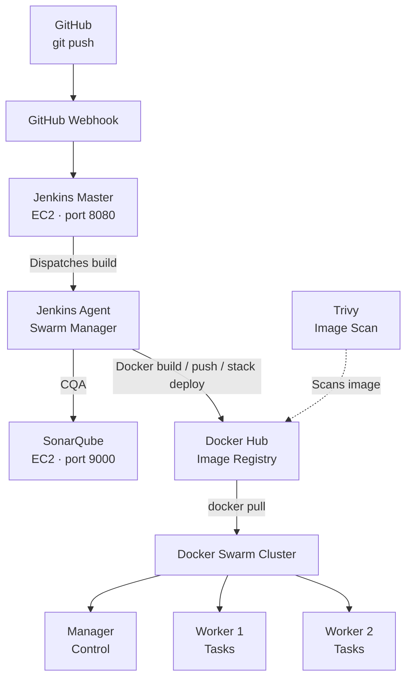

# Python Code Library App — CI/CD Pipeline

A multi-service Python Flask application deployed to a **3-node Docker Swarm cluster on AWS**. The Jenkins pipeline automates code checkout, SonarQube quality analysis, Docker image building, Trivy vulnerability scanning, publishing to Docker Hub, and stack deployment.

**Repository:** https://github.com/Harshithajam/python-code-library-app  
**Docker image:** `harshithajam/python-code-library-app`  
**Stack name:** `python-lib-stack`

## Table of Contents

- [Architecture](#architecture)
- [Technology Stack](#technology-stack)
- [Application Services](#application-services)
- [Pipeline Stages](#pipeline-stages)
- [Jenkinsfile](#jenkinsfile)
- [Dockerfile](#dockerfile)
- [Docker Stack Configuration](#docker-stack-configuration)
- [Setup Guide](#setup-guide)
- [Verification](#verification)
- [Troubleshooting](#troubleshooting)
- [Image Retention](#image-retention)
- [Security Notes](#security-notes)
- [Key Lessons](#key-lessons)
- [Project Info](#project-info)

## Architecture



## Technology Stack

| Layer | Tool | Purpose |
|---|---|---|
| Source control | GitHub | Code repository |
| CI orchestrator | Jenkins 2.580+ | Pipeline execution |
| Build agent | Jenkins SSH agent on Swarm Manager | Runs pipeline stages |
| Static analysis | SonarQube 9.x | Code quality and quality gate |
| Vulnerability scanning | Trivy | Container image scanning |
| Container registry | Docker Hub | Image storage |
| Container runtime | Docker 25.x | Container engine |
| Orchestration | Docker Swarm | 1 manager and 2 workers |
| Base OS | Amazon Linux 2023 | EC2 instances |
| Language runtime | Python 3.9-slim | Application base image |

## Application Services

| Service | File / Image | Port | Purpose |
|---|---|---:|---|
| `frontend` | `app.py` | 5000 | Web UI |
| `auth_service` | `auth/auth_service.py` | 5001 | Authentication microservice |
| `book_service` | `book/book_service.py` | 5002 | Book management |
| `borrow_service` | `borrow/borrow_service.py` | 5003 | Borrow management |
| `db` | `mysql:5.7` | 3306 | Database |

Services communicate through Docker Swarm's internal DNS using service names:

- `http://auth_service:5001`
- `http://book_service:5002`
- `http://borrow_service:5003`

## Pipeline Stages

| # | Stage | Purpose | Runs on |
|---:|---|---|---|
| 1 | `code` | Clean workspace and clone repository | Jenkins agent |
| 2 | `cqa` | SonarQube static analysis | Jenkins agent |
| 3 | `Quality Gate` | Stop pipeline if the SonarQube gate fails | Jenkins agent |
| 4 | `images` | Build image with build-number and `latest` tags | Swarm Manager |
| 5 | `scan` | Run Trivy scan for HIGH and CRITICAL vulnerabilities (report-only) | Swarm Manager |
| 6 | `push` | Push both tags to Docker Hub | Swarm Manager |
| 7 | `deploy on stack` | Deploy the stack using the new build tag | Swarm Manager |

## Jenkinsfile

The pipeline below reflects the configuration supplied for this project. Ensure the Jenkins node label, SonarQube configuration, credential IDs, and repository branch match your Jenkins setup.

```groovy
pipeline {
    agent { label 'manager' }

    options {
        buildDiscarder(logRotator(numToKeepStr: '3'))
    }

    triggers {
        githubPush()
    }

    stages {
        stage('code') {
            steps {
                deleteDir()
                git branch: 'master',
                    url: 'https://github.com/Harshithajam/python-code-library-app.git'
            }
        }

        stage('cqa') {
            steps {
                withSonarQubeEnv('mysonar') {
                    sh 'sonar-scanner -Dsonar.projectKey=python-code-library-app -Dsonar.sources=.'
                }
            }
        }

        stage('Quality Gate') {
            steps {
                waitForQualityGate abortPipeline: true, credentialsId: 'mysonar'
            }
        }

        stage('images') {
            steps {
                script {
                    def image = "harshithajam/python-code-library-app"
                    sh """
                        sg docker -c 'docker build -t ${image}:${BUILD_NUMBER} -t ${image}:latest .'
                    """
                }
            }
        }

        stage('scan') {
            steps {
                script {
                    def image = "harshithajam/python-code-library-app"
                    sh """
                        sg docker -c 'trivy image ${image}:${BUILD_NUMBER} --severity HIGH,CRITICAL --format table' || true
                    """
                }
            }
        }

        stage('push') {
            steps {
                script {
                    def image = "harshithajam/python-code-library-app"
                    withCredentials([usernamePassword(
                        credentialsId: 'dockerhub-creds',
                        usernameVariable: 'DOCKER_USER',
                        passwordVariable: 'DOCKER_PASS'
                    )]) {
                        sh """
                            sg docker -c 'echo \$DOCKER_PASS | docker login -u \$DOCKER_USER --password-stdin'
                            sg docker -c 'docker push ${image}:${BUILD_NUMBER}'
                            sg docker -c 'docker push ${image}:latest'
                            sg docker -c 'docker logout'
                        """
                    }
                }
            }
        }

        stage('deploy on stack') {
            steps {
                script {
                    def image = "harshithajam/python-code-library-app"
                    withCredentials([usernamePassword(
                        credentialsId: 'dockerhub-creds',
                        usernameVariable: 'DOCKER_USER',
                        passwordVariable: 'DOCKER_PASS'
                    )]) {
                        sh """
                            sg docker -c 'echo \$DOCKER_PASS | docker login -u \$DOCKER_USER --password-stdin'
                            sg docker -c 'export TAG=${BUILD_NUMBER} && docker stack deploy -c compose.yml --with-registry-auth python-lib-stack'
                            sg docker -c 'docker stack services python-lib-stack'
                        """
                    }
                }
            }
        }
    }
}
```

### Pipeline behavior notes

- `buildDiscarder` keeps only the last three Jenkins builds.
- `githubPush()` enables push-trigger behavior; configure the GitHub webhook and Jenkins job trigger as well.
- `deleteDir()` clears the workspace before checkout to prevent stale files.
- `sg docker -c '...'` runs Docker commands with the Docker group, as the SSH agent may not inherit supplementary groups.

## Dockerfile

The Dockerfile is located at the repository root.

Key points from the project notes:

- `COPY . .` includes service directories such as `auth/`, `book/`, `borrow/`, `templates/`, and `database/`.
- A single image is used by multiple services; `compose.yml` overrides the command for each service.

> The actual Dockerfile contents were not included in the supplied notes. Add the current Dockerfile here if you want it documented in full.

## Docker Stack Configuration

The project uses `compose.yml` as the Docker Stack definition:

```yaml
version: "3.8"

services:
  db:
    image: mysql:5.7
    environment:
      MYSQL_ROOT_PASSWORD: devopspassword
      MYSQL_DATABASE: library
    ports:
      - "3306:3306"
    volumes:
      - mydata:/var/lib/mysql
      - ./database:/docker-entrypoint-initdb.d
    networks:
      - myapp
    deploy:
      replicas: 1
      resources:
        reservations:
          cpus: "0.25"
          memory: 100M
        limits:
          cpus: "0.5"
          memory: 200M

  auth_service:
    image: harshithajam/python-code-library-app:${TAG:-latest}
    command: python auth/auth_service.py
    ports: ["5001:5001"]
    depends_on: [db]
    networks: [myapp]
    deploy:
      replicas: 1
      resources:
        reservations:
          cpus: "0.25"
          memory: 100M
        limits:
          cpus: "0.5"
          memory: 200M

  book_service:
    image: harshithajam/python-code-library-app:${TAG:-latest}
    command: python book/book_service.py
    ports: ["5002:5002"]
    depends_on: [db]
    networks: [myapp]
    deploy:
      replicas: 1
      resources:
        reservations:
          cpus: "0.25"
          memory: 100M
        limits:
          cpus: "0.5"
          memory: 200M

  borrow_service:
    image: harshithajam/python-code-library-app:${TAG:-latest}
    command: python borrow/borrow_service.py
    ports: ["5003:5003"]
    depends_on: [db]
    networks: [myapp]
    deploy:
      replicas: 1
      resources:
        reservations:
          cpus: "0.25"
          memory: 100M
        limits:
          cpus: "0.5"
          memory: 200M

  frontend:
    image: harshithajam/python-code-library-app:${TAG:-latest}
    ports: ["5000:5000"]
    depends_on: [auth_service, book_service, borrow_service]
    networks: [myapp]
    deploy:
      replicas: 1
      resources:
        reservations:
          cpus: "0.25"
          memory: 100M
        limits:
          cpus: "0.5"
          memory: 200M

networks:
  myapp:
    driver: overlay

volumes:
  mydata:
```

### Stack configuration notes

- `${TAG:-latest}` uses `latest` when `TAG` is not set.
- The pipeline sets `TAG=${BUILD_NUMBER}` so deployment uses the image built for that Jenkins run.
- `driver: overlay` is required for communication across Swarm nodes.
- `--with-registry-auth` passes registry authentication to Swarm workers.

> **Security warning:** The supplied configuration contains a database password in plain text. Replace it with a Docker secret or another secure secret-management approach before using this configuration beyond a learning environment. Do not commit real passwords, tokens, or private keys.

## Setup Guide

### Prerequisites

- AWS account with EC2 access
- Docker Hub account and repository named `python-code-library-app`
- GitHub repository or fork
- SonarQube instance (or remove/disable the `cqa` and `Quality Gate` stages)

### EC2 instances

| Instance | Role | Suggested type |
|---|---|---|
| `jenkins-master` | Jenkins controller | `c7i-flex.large` |
| `swarm-manager` | Swarm manager and Jenkins agent | `c7i-flex.large` |
| `swarm-worker-1` | Swarm worker | `t3.small` |
| `swarm-worker-2` | Swarm worker | `t3.small` |
| `sonarqube` | Static analysis | `c7i-flex.large` |

SonarQube can also be installed on the Jenkins master, as noted in the source material. Instance types are suggestions; adjust them to your region, budget, and workload.

### Security group rules

Allow only the sources that need access. In particular, do **not** expose administrative interfaces or database ports publicly.

| Type | Port | Protocol | Source / purpose |
|---|---:|---|---|
| SSH | 22 | TCP | Your trusted IP for administration |
| Swarm control plane | 2377 | TCP | Swarm-node security group |
| Node gossip | 7946 | TCP and UDP | Swarm-node security group |
| Overlay VXLAN | 4789 | UDP | Swarm-node security group |
| Application | 5000–5003 | TCP | Only required client or internal sources |
| Jenkins UI | 8080 | TCP | Your trusted IP or VPN |
| SonarQube UI | 9000 | TCP | Your trusted IP or VPN |

### Initialize Docker Swarm

On the manager node:

```bash
docker swarm init --advertise-addr <manager-private-ip>
docker swarm join-token worker
```

Run the worker join command printed by Docker on each worker node.

Verify the cluster:

```bash
docker node ls
```

### Configure the Jenkins agent

On the Swarm manager, install Java 21:

```bash
sudo yum install -y java-21-amazon-corretto-devel
```

In Jenkins, go to **Manage Jenkins → Nodes → New Node** and configure:

- **Name:** `swarm-manager`
- **Label:** `manager`
- **Remote root:** `/home/ec2-user/jenkins-agent`
- **Launch method:** SSH, using the `ec2-user` account and the appropriate private key

### Configure Jenkins credentials

| Credential ID | Kind | Value |
|---|---|---|
| `dockerhub-creds` | Username with password | Docker Hub username and Personal Access Token |
| `sonar-token` | Secret text | SonarQube user token |

The Jenkinsfile uses `credentialsId: 'mysonar'` in the quality-gate step and `withSonarQubeEnv('mysonar')` for analysis. Ensure these names match the SonarQube server and credential configuration in your Jenkins instance.

### Configure GitHub webhook

In the repository, open **Settings → Webhooks → Add webhook**:

- **Payload URL:** `http://<jenkins-public-ip>:8080/github-webhook/`
- **Content type:** `application/json`
- **Events:** Just the push event

Then enable **GitHub hook trigger for GITScm polling** in the Jenkins job configuration.

## Verification

Run these commands on the manager.

### Cluster health

```bash
docker node ls
docker stack services python-lib-stack
docker stack ps python-lib-stack
```

### Application access

```bash
curl -I http://localhost:5000
curl -I http://<manager-public-ip>:5000
curl -I http://<worker1-public-ip>:5000
```

The source notes expect HTTP 200 or a redirect from each endpoint. Actual results depend on application behavior, security-group rules, and service health.

### Service logs

```bash
docker service logs python-lib-stack_frontend --tail 50
docker service logs python-lib-stack_auth_service --tail 50
docker service logs python-lib-stack_db --tail 50
```

### Database check

```bash
docker exec -it "$(docker ps -q -f name=db)" \
  mysql -uroot -p -e "SHOW DATABASES;"
```

Enter the database password when prompted; avoid putting it directly in shell history.

## Troubleshooting

| Symptom | Possible cause | Suggested fix |
|---|---|---|
| Permission denied on `docker.sock` | Jenkins user lacks Docker access | Configure Docker group access and restart the agent; verify the effective groups |
| Cannot open `/app/auth/...` | Image may be missing application directories | Confirm the Dockerfile copies the required directories and review `.dockerignore` |
| Network cannot be used with services | Incorrect or stale network configuration | Confirm the stack uses an overlay network; inspect existing stack/network state before removing anything |
| Site unreachable after deployment | Application port is blocked | Review security-group and host firewall rules |
| Site reachable on one node only | Swarm node communication may be blocked | Check TCP/UDP 7946 and UDP 4789 between nodes |
| “This node is not a swarm manager” | Swarm not initialized on this host | Run manager initialization on the intended manager and verify node role |
| Quality gate always fails | Quality-gate condition or analysis results | Review the SonarQube gate and project analysis results rather than disabling checks blindly |
| `sonar-scanner: command not found` | Scanner not available on agent `PATH` | Install/configure the scanner or use its full path |
| Could not find credentials | Credential ID mismatch | Verify the ID used in the Jenkinsfile |
| Unauthorized on Docker Hub push | Invalid credentials or account password | Use a valid Docker Hub Personal Access Token and verify the Jenkins credential |

## Image Retention

| Location | Retention policy |
|---|---|
| Jenkins | Last 3 builds (`buildDiscarder`) |
| Local Docker images on manager | Manual cleanup unless an automated cleanup step is configured |
| Docker Hub | Configure repository retention according to account capabilities |

## Security Notes

- Never commit SonarQube tokens, database passwords, Docker Hub tokens, or private keys.
- Use Docker Hub Personal Access Tokens for CLI authentication.
- Rotate credentials periodically, especially after accidental exposure.
- For production, consider draining Swarm managers from application workloads after validating cluster capacity: `docker node update --availability drain <manager-node>`.
- SonarQube using embedded H2 is intended for evaluation, not production; use a supported external database for production.
- Use `.dockerignore` to exclude `.git`, `.env`, virtual environments, scanner output, and build artifacts from the image.
- Restrict security-group rules to trusted sources and required node-to-node traffic.

## Key Lessons

1. Docker socket permissions can differ in SSH-launched agents; verify group membership and use a secure, maintainable Docker access configuration.
2. Docker Swarm services require overlay networks for cross-node communication.
3. Swarm requires TCP 2377 for cluster management, TCP/UDP 7946 for node communication, and UDP 4789 for overlay networking.
4. Unique image tags per build help avoid accidentally reusing stale images.
5. `COPY . .` should be paired with a suitable `.dockerignore` to keep images small and avoid copying secrets.
6. Docker Swarm manages service container names; `container_name` is not used by `docker stack deploy`.
7. AWS security groups are a common cause of external connectivity problems; verify inbound and inter-node rules.
8. Use Docker Hub Personal Access Tokens rather than account passwords for CLI authentication.

## Project Info

- **Author:** Harshitha Jam
- **Repository:** https://github.com/Harshithajam/python-code-library-app
- **Image:** `harshithajam/python-code-library-app`
- **Stack name:** `python-lib-stack`
